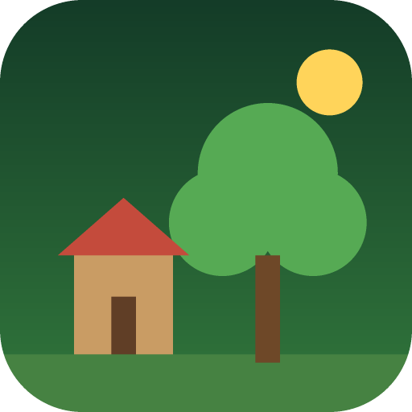
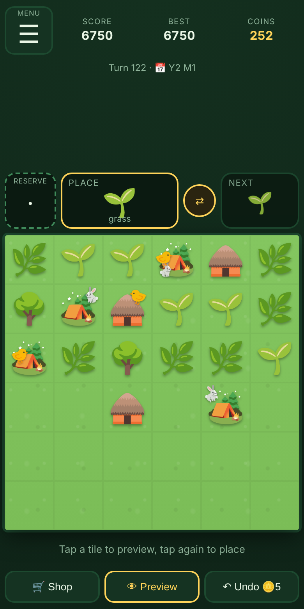

<p align="center">
  
</p>

<h1 align="center">Triple Three 🌱🌿🌳</h1>

<p align="center">
  <a href="https://sarail19th.github.io/triple-three/"><b>▶ Play now</b></a> ·
  <a href="https://twitter.com/intent/tweet?text=Triple%20Three%20%F0%9F%8C%B1%E2%86%92%F0%9F%8F%AC%20A%20free%20emoji%20merge%20puzzle%3A%20match%203%2C%20trap%20the%20bears%2C%20build%20banks.&url=https%3A%2F%2Fsarail19th.github.io%2Ftriple-three%2F">Post on X</a> ·
  <a href="https://www.facebook.com/sharer/sharer.php?u=https%3A%2F%2Fsarail19th.github.io%2Ftriple-three%2F">Facebook</a> ·
  <a href="https://www.reddit.com/submit?url=https%3A%2F%2Fsarail19th.github.io%2Ftriple-three%2F&title=Triple%20Three%3A%20a%20free%20emoji%20merge%20puzzle">Reddit</a> ·
  <a href="https://t.me/share/url?url=https%3A%2F%2Fsarail19th.github.io%2Ftriple-three%2F&text=Triple%20Three%3A%20a%20free%20emoji%20merge%20puzzle">Telegram</a>
</p>

<p align="center">
  
</p>

A merge-puzzle game played in the browser, built from emoji. Place the next item on a 6x6 board, line up three of a kind and they merge into the next tier, while bears wander the board and get trapped into tombstones. It is a free hobby project inspired by the classic genre, with its own name, code and art.

Plain HTML, CSS and JavaScript. No framework, no runtime dependencies, no image files. It installs as a PWA and works offline.

**Play:** <https://sarail19th.github.io/triple-three/> (deployed from `main` by GitHub Pages)

## Spread the word

Like it? Tell a friend. In the game, **☰ Menu → 📣 Share** opens the phone's share sheet (or copy-link and post buttons for X, Facebook, WhatsApp, Telegram and Reddit) with your score. Links to the site show a preview card (`docs/social.png`) on social networks.

## How to play

- Each turn you place the **next** item on an empty tile.
- **3 or more** orthogonally connected identical items merge into one item of the next tier, on the tile you tapped.
- Building chain: 🌱 → 🌿 → 🌳 → 🏕️ → 🛖 → 🏠 → 🏘️ → 🏫 → 🏥 → 🏬 → 💵 (cash, tap it to collect coins).
- 🐻 **Bears** wander one step a turn. A bear shut into a pocket with no empty tile becomes a 🪦 tombstone. Three tombstones merge into a ⛪ church, then a 🕌 cathedral.
- 🦊 **Foxes** warp to a random empty tile. A 💎 **crystal** stands in for whatever item completes a group.
- You have a reserve slot, a swap with the next item, and a one-level undo.
- The game ends when the board is full and you have no way out. Score is the sum of your merges, and your best is saved locally.

The in-game **How to play**, **Item guide** and first-run tour cover everything else.

## Features

- **Shop** paid with coins earned from merges: items, hammer, trap, mover, bridges, ponds, extra land, banks.
- **Wild bears** mode: bears that stay boxed in escalate, maul your buildings and breed.
- **Maps**: easy, standard, river, hard (random ponds), island, and highlands (mountains and holes).
- **World**: a 3x3 map of regions you unlock by building higher tiers, each with its own save, linked by a shared treasury.
- **Banks and loans**: banks pay income, loans lock buildings, and unpaid loans are seized. Treasury accounts carry coins between games.
- **Quests, achievements and titles** with gameplay perks.
- **Seasons**: spring, summer, autumn and winter change the colours, plants and animals.
- Deterministic and reproducible: every game comes from a seed (`#seed=123` in the URL).

## Run it locally

Requires Node.js (the CI uses 20).

```bash
node test/test.js     # logic tests plus a 400-game fuzz; prints "OK: N logic tests passed"
node build.js         # builds dist/index.html, manifest and service worker
node gen/icons.js     # PWA icons into dist/ (run after build)
python -m http.server -d dist
```

Then open <http://localhost:8000>. Opening `dist/index.html` directly also works but skips the PWA parts.

Browser test (Playwright, mobile viewport, plays seeded games to game over):

```bash
pip install playwright && python -m playwright install chromium
python test/ui_test.py
```

## Project layout

| Path | What it is |
| --- | --- |
| `src/logic.js` | Pure, deterministic game logic. State is plain JSON and all randomness goes through a seeded RNG stored in the state, so undo and replays are exact. |
| `src/game.js` | UI, animations, saves in `localStorage`, shop, quests, world. |
| `src/style.css`, `src/index.html` | Templates inlined by the build. |
| `build.js` | Inlines everything into a self-contained `dist/index.html` and writes the manifest and service worker. |
| `gen/icons.js` | Pure Node PNG writer for the PWA icons. |
| `test/` | Node logic tests and the Playwright UI test. |
| `docs/GAME_BRIEF.md` | The game spec. |
| `docs/icon.png`, `docs/screenshot.png`, `docs/social.png` | README icon and screenshot, and the 1200x630 link-preview card (`build.js` copies `social.png` to `dist/`). |
| `docs/IDEAS.md` | Roadmap notes. |
| `CLAUDE.md` | Detailed design notes and rules for working on the code. |

## Deploying

Pushing to `main` runs `.github/workflows/pages.yml`: tests, build, icons, then publish `dist/` to GitHub Pages. The service worker loads pages network-first, so players get a new version on their next visit. The ☰ Menu has an **Update** button that fetches the latest build without touching saves.

## Contributing

Run `node test/test.js` and `python test/ui_test.py` before a change. When changing the logic, keep `validate()` in sync with any new invariant, and never use `Math.random` in the logic. `CLAUDE.md` lists the rest of the rules.
